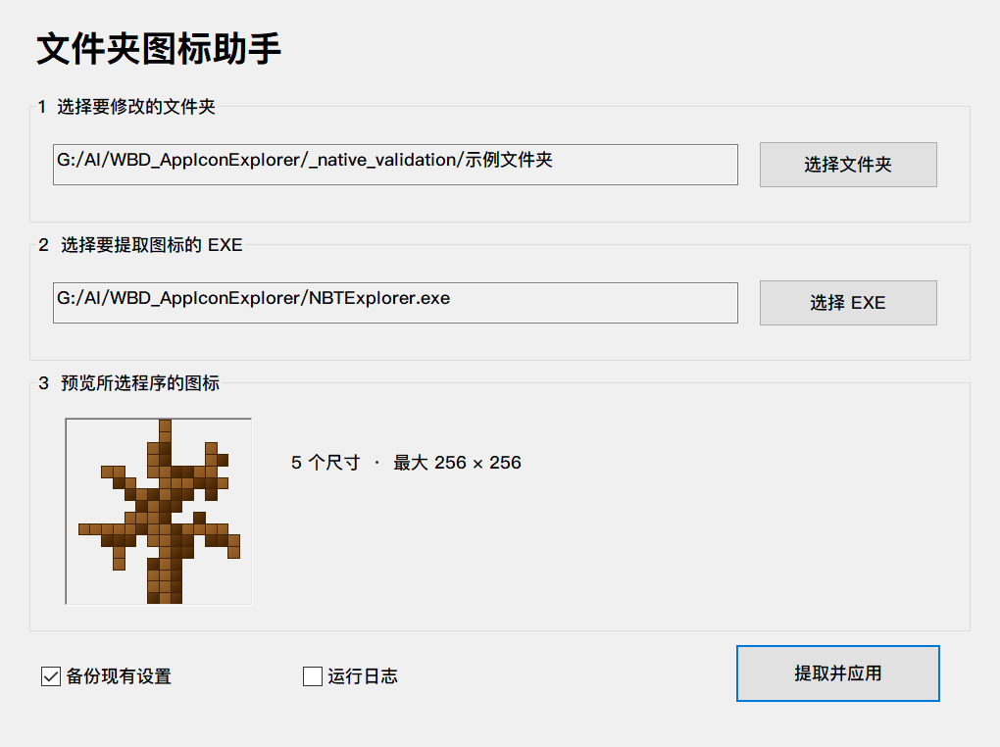

# 文件夹图标助手 · Folder Icon Tool

该程序使用Kimi K3.1Pro 和DeepSeek V4.1Flash 1017制作

把 Windows 文件夹的图标换成任意 `*.exe` 的图标，让上一层目录里的文件夹一眼就能看出里面装的是什么，而不是只能靠名字区分。

纯 Win32 / C 实现，编译产物是 **约 55 KB 的单文件 EXE**，不依赖 Python、.NET、VC++ 运行库，也不写注册表。



## 功能

- 选择目标文件夹 → 选择 `*.exe`（文件对话框默认打开该文件夹）→ 预览图标 → 一键应用。
- 直接读取 EXE 内部的 `RT_GROUP_ICON` 资源，**完整保留全部尺寸**（常见 16/24/32/48/64/128/256），不是只截一张大图，所以在小图标视图下也清晰。
- 应用前默认**备份**原有的 `desktop.ini` 和原有图标，随时可回退。
- 修改 `desktop.ini` 时**保留已有配置**（如 `LocalizedResourceName`、`[Other]` 等段落），只更新/插入 `IconResource` 一行。
- 磁盘根目录、`Windows` 系统目录受到保护，直接拒绝写入。
- 不写注册表、不改系统文件，所有改动只发生在所选文件夹内部。
- 高 DPI 适配，界面为简体中文。
- 运行日志默认关闭，需要排查问题时在界面勾选“运行日志”。

## 使用方法

1. 双击 `FolderIconTool.exe`（无需安装，可从 Releases 下载，或按下方说明自行编译）。
2. 点“选择文件夹”，选中要改图标的文件夹。
3. 点“选择 EXE”，默认会打开第 2 步的文件夹，从里面挑一个程序（也可以选任意路径的 EXE）。
4. 选择后预览区立即显示该程序的真实图标，以及图标包含的尺寸数量。
5. 点“提取并应用”。回到上一层文件夹按 `F5` 刷新，图标即已更新。

如果图标没有立刻变化，通常是资源管理器图标缓存未刷新：在上一级目录按 `F5`，或关闭再打开资源管理器窗口即可。

## 工作原理

Windows 资源管理器允许文件夹通过目录内的 `desktop.ini` 指定自定义图标。应用后文件夹结构如下：

```
所选文件夹\
├─ desktop.ini        （隐藏 + 系统属性）
└─ .FolderIcon\       （隐藏属性）
   ├─ icon.ico        （隐藏属性，多尺寸 ICO）
   └─ backup\         （历史备份：desktop_*.ini / icon_*.ico）
```

`desktop.ini` 中写入的内容：

```ini
[.ShellClassInfo]
IconResource=.FolderIcon\icon.ico,0
```

图标路径使用相对于文件夹自身的 `.FolderIcon\icon.ico`，因此**整个文件夹被移动或复制到别的电脑后，图标依然有效**，不会指向原来的 EXE 路径。

同时程序会给目标文件夹加上**只读属性**——这是 Windows 让资源管理器读取并应用 `desktop.ini` 的既定机制，并非锁定文件；文件夹内的文件仍然可以正常增删改。

## 编译

需要一个 MinGW-w64 工具链（`gcc` + `windres`），例如 [MSYS2](https://www.msys2.org/) 的 `mingw-w64-x86_64-gcc`，或 [niXman/mingw-builds](https://github.com/niXman/mingw-builds-binaries/releases)。

```bat
build.bat
```

产物为 `dist\FolderIconTool.exe`。

手动编译等价命令：

```bat
cd src
windres app.rc -O coff -o app_res.o
gcc -Os -Wall -Wextra -municode -static -static-libgcc -s -mwindows ^
    -o ..\dist\FolderIconTool.exe folder_icon_tool.c app_res.o ^
    -lcomctl32 -lcomdlg32 -lshell32 -lole32 -luuid -lgdi32 -luser32 -lkernel32
```

使用 MSVC 时，把资源文件直接用 `rc.exe` 编译，再以 `/MT /O1 /DUNICODE /D_UNICODE /SUBSYSTEM:WINDOWS` 链接同样几个库即可。

需要 32 位版本时，换用 i686 的 MinGW 工具链按同样命令编译。

## 目录结构

```
FolderIconTool/
├─ build.bat              一条命令完成编译
├─ src/
│  ├─ folder_icon_tool.c  全部程序逻辑（图标提取 / 预览 / desktop.ini 读写 / 界面）
│  ├─ app.rc              资源脚本：图标、清单、版本信息
│  ├─ app.manifest        高 DPI、Common Controls v6、普通用户权限
│  └─ app_icon.ico        程序自身图标
├─ docs/preview.png       界面截图
├─ LICENSE
└─ README.md
```

`folder_icon_tool.c` 末尾保留了开发者自测入口，加 `-DCONSOLE_TEST -mconsole` 编译可得到命令行版本：

```bat
gcc -DCONSOLE_TEST -Os -static -static-libgcc -mconsole -o FolderIconTool.Test.exe ^
    folder_icon_tool.c app_res.o ^
    -lcomctl32 -lcomdlg32 -lshell32 -lole32 -luuid -lgdi32 -luser32 -lkernel32
```

```
FolderIconTool.Test.exe --extract <exe> <out.ico>
FolderIconTool.Test.exe --apply <folder> <exe>
```

## 兼容性

- Windows 10 / Windows 11 x64 实测通过（Windows 7 理论上可用，未实测）。
- 只调用系统 DLL：`kernel32`、`user32`、`gdi32`、`comctl32`、`comdlg32`、`shell32`、`ole32`。
- 静态链接，目标机器无需安装任何运行库。

## 安全与回退

- **不修改注册表**，不触碰系统目录与系统文件。
- 所有写入仅位于所选文件夹内：新建 `.FolderIcon\`、写入/更新 `desktop.ini`。
- 勾选“备份现有设置”时，应用前会把原 `desktop.ini` 与 `icon.ico` 复制到 `.FolderIcon\backup\`。
- 恢复原样：删除该文件夹内的 `desktop.ini` 和 `.FolderIcon` 目录即可；若原本就有 `desktop.ini`，从 `.FolderIcon\backup\` 复制回去，并去掉文件夹的只读属性。

## 更新记录

- **v1.0.1** — 首个公开版本。支持 EXE 多尺寸图标提取与预览、保留原有 `desktop.ini` 配置、自动备份、系统目录保护；文件夹选择器会记住本次运行上次选中的位置；窗口标题栏显示版本号；已修复连续修改多个文件夹时的闪退，以及 `aDrive.exe` 这类图标组尺寸声明不一致的程序提取失败的问题。

## 许可证

[MIT](LICENSE)

---

**English**: A tiny native Windows tool (C / Win32, ~55 KB single EXE, no runtime dependencies) that replaces a folder's icon with the icon extracted from any `*.exe`. It writes a hidden `.FolderIcon\icon.ico` plus a `desktop.ini` inside the target folder, preserves existing `desktop.ini` entries, backs up the previous settings, and never touches the registry. Build with `build.bat` (MinGW-w64).
